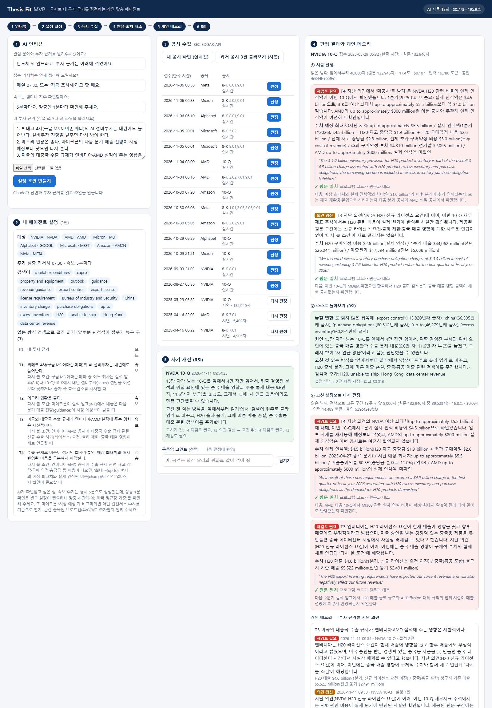

# Thesis Fit — 공시로 내 투자 근거를 점검하는 개인 맞춤 에이전트

국부펀드 KIC, AI 에이전트 공모전 예선 출품작 (팀 Thesis Fit: 문성원 · 김건우)

밤사이 몰리는 미국 공시(SEC 8-K·10-Q·10-K)를 운용역 개인의 **투자 근거** 기준으로 정리하는 AI Agent 기획입니다.
본선에서 AI 인터뷰와 운용역의 투자 근거로 개인화 Agent를 만들고, 속보(5분마다, 장중 1분)와 심층 리서치(매일 07:30 또는 요청 시)를 같은 투자 근거로 이어 봅니다.

- 기획서(최종, 2026-11-11): [`deck/KIC_최종기획서_ThesisFit_최종.pdf`](deck/KIC_최종기획서_ThesisFit_최종.pdf) (10쪽)
- 텍스트판: [`docs/최종기획서_ThesisFit_최종.md`](docs/최종기획서_ThesisFit_최종.md)

## 본선 계획 한눈에

| 항목 | 내용 |
|---|---|
| 개인화 | AI 인터뷰 + 운용역이 첨부한 투자 근거 파일에서 종목·투자 근거·주기를 뽑아 설정 초안을 만든다 |
| 개인 메모리 | 설정·의견·근거·실행일·피드백·수정 이력을 SQLite에 남겨 다음 검색·판정에 이어 쓴다 (회사 안에서만 다룬다) |
| 실행 모드 | 속보: 5분마다(장중 1분), 좁은 범위 · 심층 리서치: 매일 07:30 또는 요청 시, 넓은 범위 |
| 검색·검증 | Hybrid RAG(BM25 + 벡터 + RRF)로 원문을 찾고, 인용·금액을 원문과 대조한다 |
| 자기 개선(RSI) | 결과 자체 평가 → 설정 자동 수정 → 수정된 조건으로 재실행. 운용역 코멘트는 선택 |
| 검증 | 같은 과거 공시를 ChatGPT 기본 요청 · ChatGPT 구조화 프롬프트 · ThesisFit Agent 세 방식으로 비교 |
| 보안 | 운용역의 자료와 기록은 회사 밖으로 나가지 않고, 외부 AI에는 공개 자료만 쓴다 |

기획서 8쪽 벤치마크 그래프의 숫자는 **예시로 넣은 임의 수치**입니다. 실제 값은 본선 백테스트에서 측정합니다.

## 실제로 도는 MVP (2026-11-11)

`mvp/`에 한 화면짜리 데모가 있습니다. 아래 흐름이 실제 SEC 공시와 실제 Claude 호출로 돕니다.



| 단계 | 하는 일 |
|---|---|
| ① AI 인터뷰 | 답변 세 가지와 '내 투자 근거' 글을 Claude가 읽고 설정 초안(대상 종목·투자 근거·검색어·주기)을 만든다. 운용역이 확정해야 저장된다 |
| ② 공시 수집 | SEC EDGAR API로 대상 종목의 최근 공시(8-K·10-Q·10-K)를 가져온다. 시연용 과거 공시 3건(NVIDIA·AMD 8-K, NVIDIA 10-Q)도 불러올 수 있다 |
| ③ 검색·판정 | 읽을 범위를 고르고(BM25 검색) Claude가 투자 근거별로 '재검토 필요 / 의견 갱신 / 영향 없음'을 판정한다. 같은 투자 근거의 지난 의견(개인 메모리)을 함께 준다 |
| ④ 출처 대조 | Claude가 가져온 인용 문장이 원문에 그대로 있는지 프로그램 코드가 확인하고, 판정 기록을 해시로 봉인한다 |
| ⑤ RSI | 읽지 않은 뒤쪽에 검색어와 금액이 함께 나오면, Claude가 원인을 돌아보고 읽는 방식·검색어를 스스로 고친 뒤 다시 판정한다. 설정 변경 이력이 남는다 |

2026-11-11 시연 실행 기록: 인터뷰 1회, 공시 17건 수집(실시간 14 + 시연 3), 판정 3건(인용 8개 모두 원문 일치), RSI 1회 — Claude 호출 13회, 약 $0.77, 196초.

아직 없는 것(본선에서 개발): 벡터 검색(지금은 BM25만), 속보 자동 주기 실행(지금은 버튼), 여러 AI의 토론 구조, 후속 수익률 평가, 세 방식 비교 백테스트.

```bash
cd mvp
SEC_USER_AGENT="이름 이메일" python app.py     # http://127.0.0.1:8770
```

Claude 호출은 `agent/llm.py`를 거칩니다(키는 `telegram_config.py`, 서버 이름·운영 시간 제한은 환경에 맞게 수정).

## 폴더 구성

| 폴더 | 내용 |
|---|---|
| `deck/` | 최종 기획서 PDF·PPTX |
| `docs/` | 텍스트판 기획서, 진행 기록(한계·기각 사항), 숫자 근거(재료집), 데이터 이용 조건 점검 |
| `mvp/` | 실제로 도는 데모. `app.py`(서버·수집·검색·판정·출처 대조·개인 메모리·RSI), `index.html`(화면), `screenshot.png` |
| `agent/` | 예선 기간 사전 시험 코드. `thesis_guard_pilot.py`(공시 수집 · 즉시 경보 · AI 판정 · 인용 원문 대조 · 판정 기록 해시 봉인 · 주간 요약), `llm.py`(Claude API 공용 창구: 사용 장부·비용 상한·운영 시간 제한) |
| `backtest/` | 읽기 전략 단건 시험. `rsi_bt.py`(현재 규칙 판정 → 원인 분석·수정안), `rsi_after.py`(전체 읽기 vs 골라 읽기 재판정) |
| `results/` | 실제 실행 기록. `rsi_bt.jsonl`(단건 시험 판정·수정안·승인 기록, 각 줄 해시 봉인), `test.jsonl`(시험 판정 1건) |
| `archive/v1/` | 이전 판(2026-11-10 오후, "RSI + 사람 최종 승인" 기조): 기획서 PDF·PPTX, 텍스트판, 생성 스크립트 |

`agent/`·`backtest/`는 본선 MVP가 아니라 예선 기간에 돌려 본 **사전 시험 코드**입니다. 본선 범위(개인 메모리 고도화, 속보 자동 주기, 여러 AI의 토론, 비교 백테스트)는 `mvp/`를 바탕으로 넓힙니다.

## 사전 시험 기록 (2026-11-09)

- 시험 판정 1건: NVIDIA 8-K, 인용 원문 일치, 12초, 약 $0.04 (Claude Opus 5.5)
- 읽기 전략 단건 시험: NVIDIA 10-Q(2025-05-29) 본문 146,294자 중 'H20 실제 비용 45억 달러'는 42,271번째 글자에 있어, 앞 40,000자만 읽으면 놓칩니다.

| 방식 | 결과 | 비용 |
|---|---|---|
| 원래 규칙(앞 4만 자) | ✗ 못 찾음 | $0.098 |
| 전체 다 읽기 | ✓ 찾음 | $0.238 |
| 골라 읽기(핵심 검색어 주변만) | ✓ 찾음 | $0.072 |

사례가 1건뿐이라 일반화할 수 없습니다. 한계는 `docs/진행기록_한계와_기각사항.md`에 정리했습니다.

## 사전 시험 코드 실행

```
*/5 * * * *   python thesis_guard_pilot.py poll       # SEC 8개사 새 공시 확인, 8-K 4.02·2.06은 규칙으로 즉시 경보
0 22 * * 1-4  python thesis_guard_pilot.py judge      # 매일 07:00 KST AI 판정 (서버 시계 UTC)
10 22 * * 4   python thesis_guard_pilot.py report tg  # 금요일 주간 요약
python thesis_guard_pilot.py test NVDA                # 최근 8-K 1건으로 시험 판정
```

```bash
pip install requests anthropic python-pptx
```

- `telegram_config.example.py`를 `telegram_config.py`로 복사해 키를 넣습니다(이 파일은 커밋하지 않습니다).
- SEC는 연락처가 든 User-Agent를 요구합니다: 환경 변수 `SEC_USER_AGENT="이름 이메일"`을 설정하세요.
- `llm.py`는 비용 사고를 막기 위해 특정 서버 이름(`ONLY_HOST`)과 운영 시간에서만 호출하도록 막혀 있습니다. 다른 환경에서는 이 값을 바꿔야 합니다.

## 데이터와 보안

- MVP는 누구나 쓸 수 있는 SEC 공개 데이터만 씁니다. SNS·블룸버그 등은 약관·API 계약 범위 안에서만 확장합니다.
- 키·토큰·개인정보는 저장소에 넣지 않습니다.
